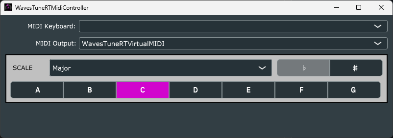

# WavesTuneRTMidiController
This application was created to simultaniously control the `Scale Root` and `Scale Type` parameters of multiple instances of the "Waves Tune Real-Time" plugin within [Studio One 6](https://www.presonus.com/products/Studio-One/new-in-studio-one-6). The plugins can be controlled using the user interface as well as an external MIDI keyboard. Even though Studio One was the DAW targetted when making this application, it could still work with other DAWs that support plugin parameter control via MIDI.

Studio One 6 has the following limitations that necessitated the need for this application:
1. No support for grouping multiple plugin parameters together across tracks such that they can all be controlled together.
1. Cannot globally connect multiple plugin parameters to the same MIDI control such that changing the MIDI control changes all of the parameters associated with it.
1. Cannot use MIDI notes to update plugin parameters.

This application's UI mirrors the `Scale` section of "Waves Tune Real-Time" (v14) plugin and allows you to control up 6 instances of the plugin by outputing 6 copies of the MIDI control value for both the `Scale Root` and `Scale Type` that is selected. These MIDI controls can then be assigned to the `Scale Root` and `Scale Type` parameters of the various plugin instances within Studio One.



Additionally, you can select a MIDI keyboard and use the keyboard notes to control the `Scale Root` value. Pressing a note on the MIDI keyboard will set the `Scale Root` to corresponding value for the note played regardless of octive. You cannot control the `Scale Type` value with the MIDI keyboard.

## Virtual MIDI Output Device
This program creates a virtual MIDI device to allow direct communication with a DAW running on the same machine. To use this virtual MIDI device, `WavesTuneRTVirtualMIDI` must be selected as the MIDI Output.

- **macOS:** the virtual device is created with CoreMIDI. Nothing extra needs to be installed.
- **Windows:** the virtual device is created with the [teVirtualMIDI](https://www.tobias-erichsen.de/software/virtualmidi.html) driver, using the [juce-tevirtualmidi](https://github.com/dcroper/juce-tevirtualmidi) patch to JUCE. The driver must be installed first (see below). Without it, the virtual device can't be created, but you can still choose any other MIDI output.

## Installing

### macOS
1. Copy `WavesTuneRTMidiController.app` into `/Applications`.
1. The app is not notarized. The first time you open it, right-click the app and choose **Open**, then confirm. If macOS still blocks it, go to **System Settings > Privacy & Security** and click **Open Anyway**.

The app requires macOS 12 or later and runs natively on both Apple silicon and Intel Macs.

### Windows
1. Install the teVirtualMIDI driver by installing either [loopMIDI](https://www.tobias-erichsen.de/software/loopmidi.html) or [rtpMIDI](https://www.tobias-erichsen.de/software/rtpmidi.html). You don't need to create any ports in them.
1. Copy `WavesTuneRTMidiController.exe` anywhere you like and run it.
1. In your DAW, enable `WavesTuneRTVirtualMIDI` as a MIDI input.

## Building
The project uses [CMake](https://cmake.org) 3.22 or later and [JUCE](https://github.com/juce-framework/JUCE) 9.0.6. CMake downloads JUCE and the [juce-tevirtualmidi](https://github.com/dcroper/juce-tevirtualmidi) patch, and applies the patch, the first time you configure. This needs git and an internet connection.

### macOS
Requires Xcode and CMake (for example `brew install cmake`). Build a universal (Apple silicon + Intel) Release app:
```
cmake -B build -G Xcode
cmake --build build --config Release
```
The app is written to `build/WavesTuneRTMidiController_artefacts/Release/WavesTuneRTMidiController.app`. Open `build/WavesTuneRTMidiController.xcodeproj` to work in Xcode.

### Windows
Requires Visual Studio 2022 with the **Desktop development with C++** workload, which includes CMake. From a **Developer PowerShell for VS 2022**:
```
cmake -B build -G "Visual Studio 17 2022" -A x64
cmake --build build --config Release
```
The app is written to `build\WavesTuneRTMidiController_artefacts\Release\WavesTuneRTMidiController.exe`. Open `build\WavesTuneRTMidiController.sln` to work in Visual Studio. You can also open the folder directly in Visual Studio, which reads `CMakeLists.txt` itself.

### Working on the patch
To build against a local copy of juce-tevirtualmidi instead of the one on GitHub, start from an empty `build` folder and run:
```
cmake -B build -DFETCHCONTENT_SOURCE_DIR_JUCE_TEVIRTUALMIDI=../juce-tevirtualmidi
```

## License
WavesTuneRTMidiController is licensed under the [GNU Affero General Public License v3.0](LICENSE) (AGPLv3).

This application uses the [JUCE Framework](https://juce.com), whose modules are used here under the terms of the [AGPLv3](https://www.gnu.org/licenses/agpl-3.0.en.html). JUCE is also available under a commercial licence from Raw Material Software Limited.

The [juce-tevirtualmidi](https://github.com/dcroper/juce-tevirtualmidi) patch adds a file to JUCE that is provided under the ISC license.
